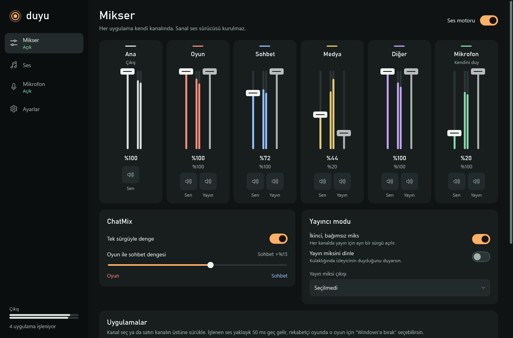
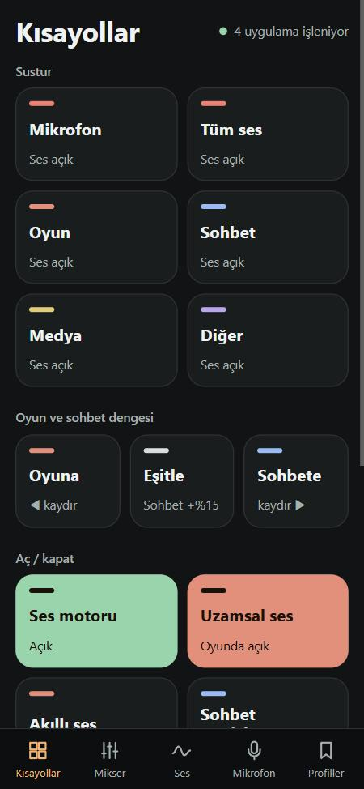
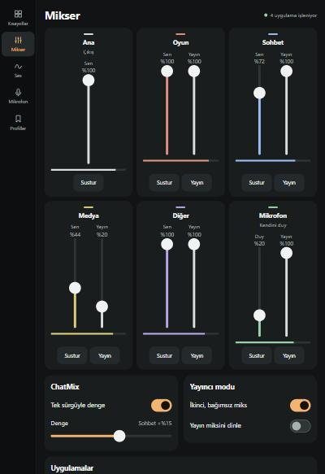

# Duyu

Windows için oyuncu ses mikseri. Sürücü, hesap, internet ve yönetici izni gerektirmez (telefondan ayar için Tailscale gerekir).



 

## Çalıştır

[Releases](https://github.com/ErdemOzbaykus/Duyu/releases/latest) sayfasındaki zip'i aç ve `Duyu.exe`'yi çalıştır (imzasız olduğu için SmartScreen uyarabilir).
Kaynaktan kullanacaksan önce derle (aşağıda "Derle ve test et"), sonra `dist\Duyu.exe`. Yanındaki `Duyu.Engine.dll` ile aynı klasörde kalmalı.
Gereken: Windows 11 x64 (veya Windows 10 build 20348+).

1. **SteelSeries Sonar'ı ve benzeri mikserleri kapat**, Windows varsayılan çıkışını kulaklığın yap.
2. **Mikser** sayfasında "Ses motoru"nu aç. Uygulamalar kanallara kendiliğinden dağılır.

Kısayollar: `Ctrl+Shift+F11` mikrofon, `F12` tüm ses, `F7/F8` ChatMix (hepsi Ctrl+Shift ile).

## iPhone ve iPad'den ayar

1. PC: Ayarlar > **Telefon ve tablet** > Uzaktan ayar. Adres ve 6 haneli kod görünür.
2. iPhone/iPad: Tailscale'i bağla, Safari'de adresi `http://` ile birlikte aç, Paylaş > Ana Ekrana Ekle.
3. Simgeden aç, kodu gir. Kod 5 dakika geçerlidir, iki cihazı da aynı kodla ekleyebilirsin.

Sayfalar: Kısayollar, Mikser, Ses, Mikrofon, Profiller. Profiller ve yıldızlı hazır ayarlar Kısayollar'da düğme olur.

- Varsayılan kapalı. Yalnızca Tailscale adresini dinler, yalnızca tailnet'ten kabul eder, ses göndermez.
- PC'de Duyu açık ve bilgisayar uyanık olmalı.
- Telefondan mikrofon işleme açılamaz (kapanır), ses motoru ilk kez PC'de açılmalıdır.
- Bağlanmıyorsa: telefonda Tailscale açık mı, PC'de adres görünüyor mu, Windows Güvenlik Duvarı'nda Duyu engelli mi?
- Port sabit: 47800.

## Sonar ile karşılaştırma

| Özellik | Duyu | Not |
|---|---|---|
| Oyun / Sohbet / Medya / Diğer / Mikrofon mikseri | Var | sürükle-bırak, otomatik dağıtım |
| ChatMix | Var | kısayollu |
| 10 bant parametrik EQ | Var | 6 filtre türü, bas / ses / tiz |
| Hazır ayarlar | 59 | Sonar'ın oyun ve pro oyuncu kütüphanesi yok. Favori, arama, paylaşım kodu, AutoEq içe aktarma var |
| Uzamsal ses 7.1 | Var | parametrik kafa modeli, ölçülmüş HRTF değil |
| Ses güçlendirme, akıllı ses | Var | +12 dB, limitleyicili |
| Yayıncı modu | Var | ikinci çıkış aygıtı veya sanal kablo gerekir |
| Kanal başına çıkış aygıtı | Var | |
| Mikrofon: EQ, kapı, kompresör, sabitleme, test | Var | |
| Gürültü engelleme | Kısmen | klasik DSP, yapay zeka değil |
| Sanal mikrofon | Yok | imzalı sürücü ister. Sanal kabloya çıkış verilebilir |
| Topluluk ayar mağazası | Yok | sunucu ister |
| Oyun profilleri, kısayollar, tepsi | Var | |
| Kendini duy | Var | mikrofon zincirinden sonra |
| Kulaklık düzeltme EQ'su | Var | kendini duyma dahil her şeye |

## Nasıl çalışıyor

```
uygulama ─► Windows oturumu (kanal sesi -80 dB) ─► kulaklık (duyulmaz)
                 │
                 └─ process loopback ─► +80 dB ─► EQ / uzamsal / mikser ─► limitleyici ─► kulaklık

mikrofon ─► gürültü azaltma / kapı / EQ ─► kendini duy ──────────────────────────────────┘
```

Windows mikserindeki sürgü oturumun *ana* sesidir, ona dokunulmaz. Yalnızca oturumun kanal sesi değişir.

### Güvenlik

- Kısılmamış bir akış yakalanırsa blok atılır, 80 dB yüksek çalınmaz.
- Ana çıkış seçilen tavanı geçemez. NaN ve sonsuz değer kulağa ulaşmaz.
- Windows kanal sesini uygulama başına kalıcı saklar. Bu yüzden özgün değer kısmadan *önce* günlüğe yazılır
  (`%LOCALAPPDATA%\Duyu\restore.journal`).
- Motor açıkken bir bekçi süreç çalışır. Duyu çökerse sesleri geri verir. Kısılmışken kapanmış bir uygulama
  varsa tekrar açılana kadar bekler.
- Elektrik kesintisine karşı `HKCU\...\RunOnce\DuyuRestore` kaydı yazılır, iş bitince silinir.
- **Silmeden önce:** motoru kapat, motor açıkken kullandığın uygulamaları bir kez aç (Ayarlar > Ses güvenliği
  "Onarım bekleyen ses yok" demeli), sonra klasörü sil.

## Sınırlar

- **Gecikme:** uygulamadan motora 50–60 ms ölçüldü, çıkış tamponuyla toplam 65–75 ms. Bunun ne kadarının
  doğrudan çalmaya göre fazladan olduğu ölçülmedi (tahminen 50 ms). Rekabetçi oyunda o oyunu "Windows'a bırak" yapabilirsin.
- WASAPI exclusive ve ASIO kullanan uygulamalar yakalanamaz.
- Başka bir sesli uygulamayı başlatmış uygulama (ör. oyunu açan launcher) işlenmez, doğrudan çalar.
  Windows yakalamayı süreç ağacı olarak yaptığı için aksi halde ses iki kez duyulurdu. Oyunun kendisi işlenir.
- Gerçek 7.1 için oyunun gördüğü çıkış aygıtı 8 kanallı olmalıdır.

## Derle ve test et

Visual Studio 2022 Build Tools (C++) yeterli. Paket indirilmez.

```powershell
powershell -ExecutionPolicy Bypass -File .\build.ps1 -Test
```

- `tests/dsp_tests.cpp`: çevrimdışı DSP testleri.
- `tests/e2e.cpp`: gerçek WASAPI testi, yalnızca kendi alt sürecine dokunur. Seçilen çıkışa -60 dBFS ton çalar.
- `tests/latency.cpp`: uygulama yolu gecikme ölçümü.
- `python -I tests/remote_test.py dist/Duyu.exe`: mobil API ve güvenlik testleri, yalnızca loopback.
- `Duyu.exe --preview`: sesle ilgisiz arayüz önizlemesi.
- `Duyu.exe --shots <klasör> [--worst]`: ekran görüntüleri.
- `Duyu.exe --smoke <klasör>`: yalıtılmış duman testi.

## Klasörler

```
engine/  C++20 motor: dsp.h, graph.h (sinyal akışı), wasapi.h, system.h, engine.cpp (C ABI)
ui/      WPF (.NET Framework 4.8, Windows ile gelir)
tests/
```

## Lisans

[MIT](LICENSE)

---

SteelSeries ve Sonar, sahiplerinin markalarıdır. Duyu bağımsız bir projedir, SteelSeries ile bağlantısı yoktur.
